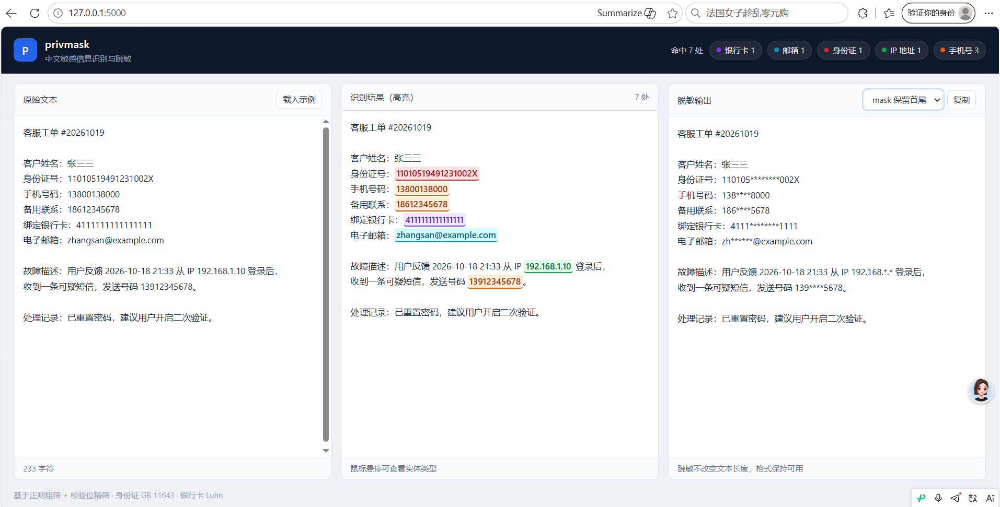
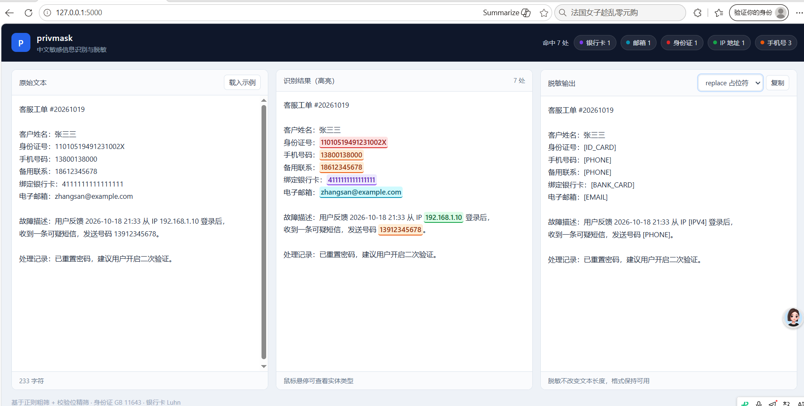
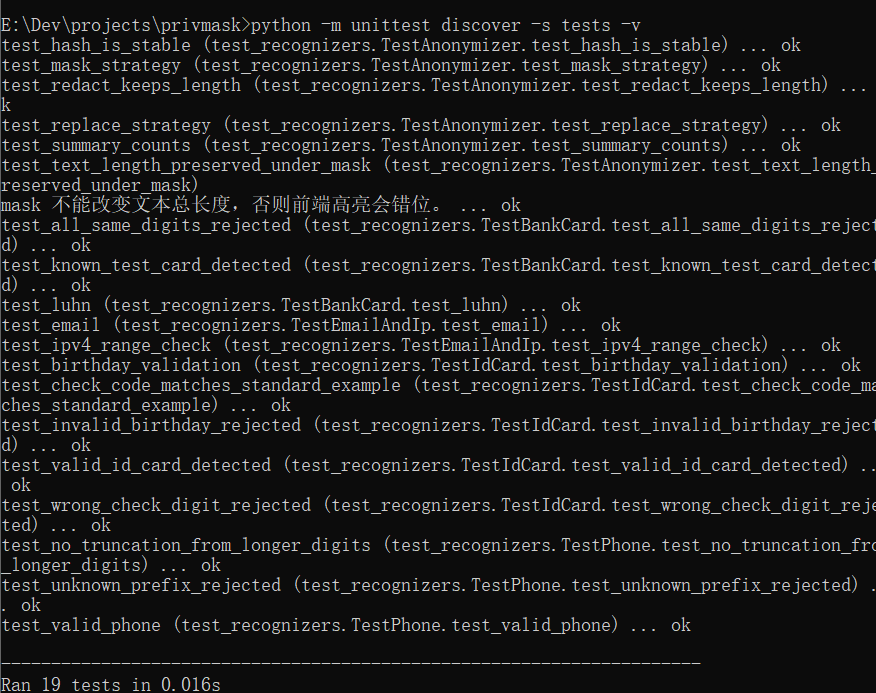

# privmask

面向中文场景的敏感信息识别与脱敏工具。核心引擎只用 Python 标准库，零第三方依赖；仅 Web 界面需要 Flask。

## 它解决什么问题

处理日志、客服记录、测试数据时，经常需要把里面的身份证号、手机号、银行卡号去掉再给别人看。
用正则硬匹配误报太多：`123456789012345678` 会被当成身份证，`1380013800012` 会被截成手机号。

privmask 在正则之上加了一层**校验**：

| 实体类型 | 识别方式 | 挡掉什么 |
|---|---|---|
| `ID_CARD` | 18 位 + GB 11643 校验位 + 日期合法性 + 省级行政区码 | 随便编的 18 位数字 |
| `PHONE` | 11 位 + 工信部号段前缀 + 边界约束 | 被截断的长数字、不存在的号段 |
| `BANK_CARD` | 16–19 位 + Luhn 校验 | 输错一位的卡号、全相同数字 |
| `EMAIL` | RFC 风格正则 + 长度上限 | 拼凑出来的假邮箱 |
| `IPV4` | 正则 + 每段 0–255 范围校验 | 版本号、超范围地址 |

## 效果

### 网页界面



三栏分别是原始文本、识别高亮、脱敏输出。顶部按实体类型统计命中数量，中间每种类型颜色不同。

切换脱敏策略时右侧实时更新，不需要重新输入：



### 命令行

```
$ python cli.py analyze -f examples/sample.txt

共发现 9 处敏感信息：

  类型            内容                        位置
  ------------------------------------------------------------
  ID_CARD       11010519491231002X        [10, 28)
  PHONE         13800138000               [32, 43)
  BANK_CARD     4111111111111111          [51, 67)
  EMAIL         zhangsan@example.com      [71, 91)
  IPV4          192.168.1.10              [105, 117)
  PHONE         13912345678               [155, 166)
  PHONE         18612345678               [191, 202)
  EMAIL         lisi@company.com.cn       [210, 229)
  IPV4          10.20.30.40               [240, 251)
```

脱敏效果：

```
$ python cli.py mask -f examples/sample.txt -s mask

客户张三，身份证号 110105********002X，手机 138****8000，
绑定银行卡 4111********1111，邮箱 zh******@example.com，
最近一次登录 IP 为 192.168.*.*。
```

日志脱敏（这是实际工作里最常见的场景）：

```
$ python cli.py mask -f examples/access.log -s mask

2026-10-19 10:23:11 [INFO] user 138****8000 login from 192.168.*.*
2026-10-19 10:24:02 [INFO] payment user=138****8000 card=4111********1111 amount=299.00
2026-10-19 10:26:10 [INFO] profile update email=zh******@example.com id=110105********002X
```

## 快速开始

需要 Python 3.9+。本项目零第三方依赖，装好 Python 就能跑，不用 `pip install` 任何东西。

### 最省事的方式

双击项目根目录下的 **`demo.bat`**，它会自动跑两个示例并停住等你查看。

### 网页界面

双击 **`start_web.bat`**，浏览器会自动打开 `http://127.0.0.1:5000`。也可以用命令行启动：

```bash
python server.py
```

界面分三栏：左边粘贴文本，中间实时高亮识别结果，右边显示脱敏后的文本。顶部统计各类实体的命中数量，右上角可切换脱敏策略并一键复制。

前端是单文件原生 JavaScript，不依赖任何 CDN，**断网也能正常演示**——这一点在面试现场很重要。

> 第一次用网页界面需要先装 Flask：`python -m pip install flask`

### 命令行

```bash
# 识别
python cli.py analyze "我的手机号是 13800138000"

# 从文件识别，输出 JSON
python cli.py analyze -f examples/sample.txt --json

# 脱敏
python cli.py mask -f examples/sample.txt -s mask

# 写入文件
python cli.py mask -f examples/access.log -s mask -o masked.log

# 不确定识别对不对时，用这个标出命中片段
python cli.py mask -f examples/sample.txt --show-segments
```

四种脱敏策略：

| 策略 | 输入 | 输出 | 适用场景 |
|---|---|---|---|
| `mask` | `13800138000` | `138****8000` | 给人看、做演示，保留可读性 |
| `replace` | `13800138000` | `[PHONE]` | 写文档、做标注 |
| `hash` | `13800138000` | `a3f9c1e2` | 需要统计关联（同一个号哈希后仍相同） |
| `redact` | `13800138000` | `***********` | 彻底不可逆 |

## 作为库使用

```python
from privmask import Engine, Anonymizer

engine = Engine()
anonymizer = Anonymizer(strategy="mask")

text = "联系我 13800138000，身份证 11010519491231002X"
entities = engine.analyze(text)
print(anonymizer.anonymize(text, entities))
```

## 项目结构

privmask/
├── cli.py                       命令行入口
├── server.py                    Web 服务（Flask）
├── web/index.html               前端页面（单文件，无构建，无 CDN）
├── Dockerfile                   容器镜像
├── docker-compose.yml           一键启动
├── demo.bat                     双击跑命令行示例
├── start_web.bat                双击启动网页界面
├── docs/简历与面试话术.md        项目讲解与答辩准备
├── privmask/
│   ├── entities.py              Entity 数据结构
│   ├── engine.py                识别引擎 + 重叠消解
│   ├── anonymizer.py            四种脱敏策略
│   └── recognizers/
│       ├── base.py              识别器基类
│       ├── id_card.py           身份证（含校验位算法）
│       ├── phone.py             手机号（含号段校验）
│       ├── bank_card.py         银行卡（含 Luhn）
│       └── misc.py              邮箱、IPv4
├── examples/                    示例数据
└── tests/                       单元测试
```

## 两个设计上的选择

**1. 为什么用 `(start, end)` 下标而不是直接替换字符串**

同一段文字里可能出现两个相同手机号。用 `text.replace()` 会同时替换掉，但我们需要按识别结果精确处理。
另外前端做高亮必须知道每个片段在原文的位置，替换后的文本做不到这一点。

**2. 多识别器冲突怎么处理**

一段 19 位数字可能同时被银行卡识别器命中，中间还夹着一段像手机号的 11 位。
引擎按「置信度高 → 长度长 → 位置靠前」排序，贪心收录不重叠的结果，保证同一段文字只被处理一次。

## 关于 Presidio

微软的 [Presidio](https://github.com/microsoft/presidio) 是这个领域更完整的框架，但它默认的识别器基本围绕英文和美国证件设计，
中文的身份证、号段规则需要自己补；而且它依赖 spaCy / transformers，安装体积大、在 Windows 上容易卡在编译环节。

所以这个项目选择自己实现核心引擎，做到零依赖、随处可跑。后续如果需要更强的语义识别（比如从自由文本里认出中文姓名），
可以接 Presidio 的 NER 能力做补充——这也是下一步计划。

## 部署

### 本地

双击 `start_web.bat`，或运行 `python server.py`。

服务默认只监听 `127.0.0.1`，**不会暴露到局域网**——这是有意的，因为处理的是敏感数据。

### 容器

容器内通过环境变量把监听地址改为 `0.0.0.0`（已写在 Dockerfile 里）：

```bash
docker compose up -d
```

或手动构建运行：

```bash
docker build -t privmask:0.1 .
docker run --rm -p 5000:5000 privmask:0.1
```

镜像基于 `python:3.13-slim`，以非 root 用户运行，内置健康检查。

## 测试

```bash
python -m unittest discover -s tests -v
```

当前 19 个用例，覆盖校验位、边界、误报拦截、脱敏正确性。



## 已知局限

- **姓名字段识别不了**：中文姓名没有校验位，靠正则误报极高，需要 NER 模型，暂未实现
- **地址识别未实现**：同理
- **号段表需要维护**：工信部放新号段后要补，否则新号段的手机号识别不出来
- **不支持港澳台证件**：当前只处理大陆 18 位身份证

## 合规说明

本项目用于数据合规处理与安全研究。识别与脱敏应当只作用于**你有权处理的数据**。
不得用于对未授权系统进行数据采集。

## License

MIT
